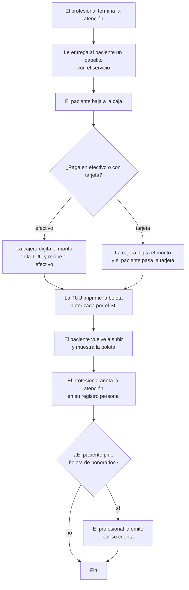
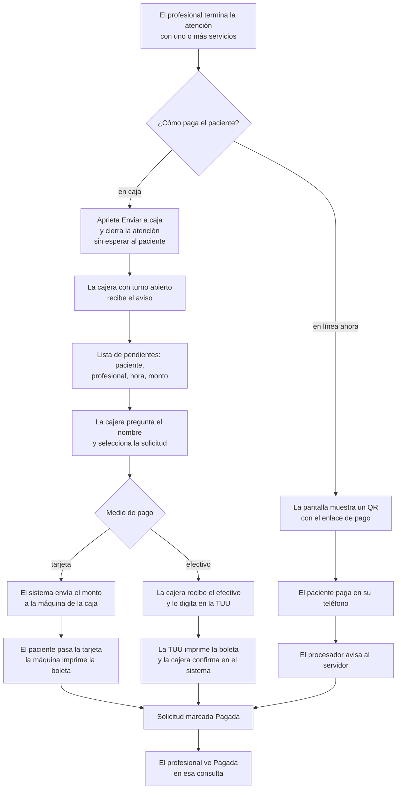

# Cobro después de la atención

Esta página muestra cómo paga el paciente una consulta una vez que el profesional lo atendió.
El **cobro** es el paso entre «la atención terminó» y «la clínica tiene el dinero y el
paciente tiene su boleta» (el documento que el SII, el Servicio de Impuestos Internos, exige
por cada venta). Te lo encontrarás al tocar el cierre de una atención, `payment_manager` o
`cash_manager`.

La clínica tiene dos máquinas de cobro TUU (terminales de tarjeta de la empresa chilena
Haulmer, ver [veltylabs/tuu](https://github.com/veltylabs/tuu)): una para las consultas y otra
para la farmacia, así cada caja se cuadra por separado. La máquina imprime la boleta tanto
en efectivo como con tarjeta.

## 1. Hoy (papelito)

El profesional atiende en el segundo piso; la caja está en el primero.

## 2. Decidido (sin papel; la cajera solo digita los pagos en efectivo)

> STATUS (borrar esta nota cuando cierre MONEY_FLOWS_MASTER_PLAN): flujo decidido; qué procesador
> en línea se usa sigue abierto en ese master.

Una **solicitud de pago** es la cuenta de una consulta: el paciente, el profesional que la
envió, la hora y sus servicios (uno o varios), cada uno con la tarifa del servicio. El
profesional no puede cambiar el monto.

La máquina de cobro y el procesador en línea (TUU hoy, Transbank u otro mañana) se eligen con
una configuración en la base de datos, no en el código: los módulos solo ven los puertos de
`payment_manager`.
