# Ubicación del Módulo (Placement)

Este documento detalla qué dependencias importa este módulo y qué módulos externos lo importan a su vez, demostrando la ubicación de `clinical_encounter` dentro del ecosistema Velty.

## Contexto

`clinical_encounter` forma parte de las capas internas del sistema y no importa a sus módulos hermanos. Es importado y utilizado directamente por la aplicación final (como `app`).

## Diagrama

```mermaid
flowchart TD
    %% Dependencias Importadas
    clinicalEncounter[github.com/veltylabs/clinical_encounter] --> webtypAppkit[webtyp.com/appkit]
    clinicalEncounter --> webtypComponents[webtyp.com/components]
    clinicalEncounter --> webtypCrud[webtyp.com/crud]
    clinicalEncounter --> webtypDdl[webtyp.com/ddl]
    clinicalEncounter --> webtypDom[webtyp.com/dom]
    clinicalEncounter --> webtypEvents[webtyp.com/events]
    clinicalEncounter --> webtypFmt[webtyp.com/fmt]
    clinicalEncounter --> webtypForm[webtyp.com/form]
    clinicalEncounter --> webtypInput[webtyp.com/input]
    clinicalEncounter --> webtypLayout[webtyp.com/layout]
    clinicalEncounter --> webtypModel[webtyp.com/model]
    clinicalEncounter --> webtypMsgtype[webtyp.com/msgtype]
    clinicalEncounter --> webtypNotify[webtyp.com/notify]
    clinicalEncounter --> webtypOrm[webtyp.com/orm]
    clinicalEncounter --> webtypRouter[webtyp.com/router]
    clinicalEncounter --> webtypStorage[webtyp.com/storage]
    clinicalEncounter --> webtypSvg[webtyp.com/svg]
    clinicalEncounter --> webtypTime[webtyp.com/time]
    clinicalEncounter --> webtypUnixid[webtyp.com/unixid]
    clinicalEncounter --> webtypView[webtyp.com/view]

    %% Consumidores
    veltyApp[github.com/veltylabs/app] --> clinicalEncounter
```

## Guía paso a paso (Walkthrough)

1. **Dependencias del ecosistema WebTyp**: El módulo importa componentes clave de la infraestructura técnica `webtyp.com/*` que proporcionan enrutamiento, modelos, renderizado de vistas, persistencia, manejo de eventos y utilidades de fechas, entre otros.
2. **Independencia en su capa**: No se ven módulos hermanos (por ejemplo, los de gestión de inventario, reservas o cobros) del propio dominio `github.com/veltylabs/*` dentro de los módulos requeridos por `clinical_encounter`.
3. **Punto de integración**: El módulo completo es empaquetado y registrado en la raíz del entorno final en `veltylabs/app`, que importa `veltylabs/clinical_encounter` y organiza el inicio, las vistas cruzadas y las rutas.
